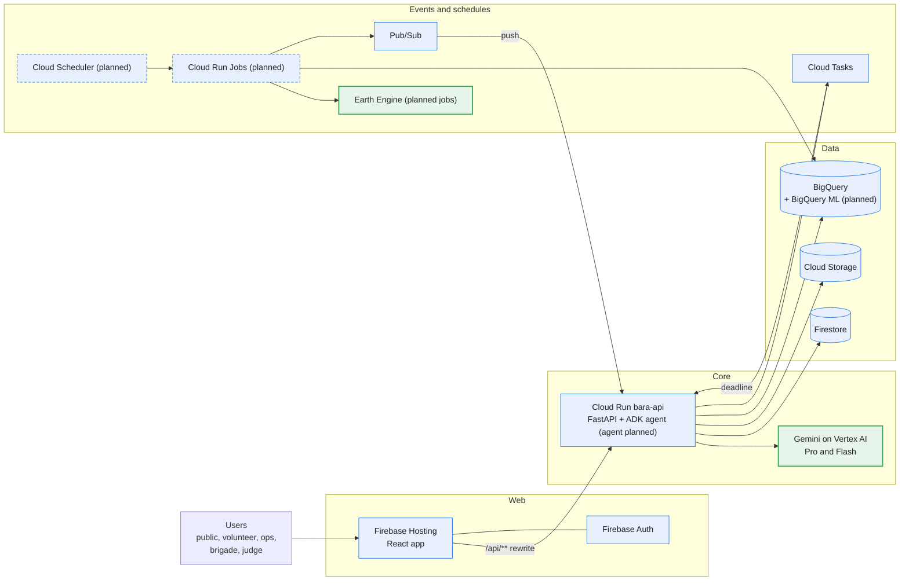

# Bara

> Submission for **Google Cloud AI Builder Cup 2026** by team **Faber Fathers**.
>
> - Rizqy EP (rizqyepr@gmail.com)
> - Rama Dhaniansyah (dhaniansyahr@gmail.com)
> - Rafizhafran Halmi (rzh.halim@gmail.com)
> - Ramel Akil Pratama (ramelakil76@gmail.com)

A Gemini agent on Google Cloud that ranks drying peat before the dry season, scores where a burned area
may reignite, sends a named person to check, reads their evidence, and escalates to the fire brigade.

Google Cloud AI Builder Cup 2026, Sustainability and Social Impact.

The live link, architecture and eval numbers are added as each wave ships. The spec and the plans live in the team's internal docs; every deviation from them is in [`docs/DECISIONS.md`](./docs/DECISIONS.md).

## Architecture



Legend: blue is a Google Cloud service. Green outline is an AI or geo-compute service (Vertex AI Gemini,
Earth Engine, BigQuery ML). Dashed is planned.

Google Cloud services:

- **Firebase Hosting:** serves the web app and rewrites `/api/**` to Cloud Run.
- **Cloud Run:** runs `bara-api` (FastAPI). The ADK agent and the batch jobs are planned.
- **Vertex AI, Gemini:** Gemini 3.1 Pro for agent reasoning and Gemini 3.5 Flash for evidence reading and task wording, with a fallback model.
- **Agent Development Kit:** the agent that runs each case to closure (planned).
- **Earth Engine:** Sentinel-1, rainfall, peat and fire data for the drying score (planned jobs).
- **BigQuery:** the 1 km grid, weekly drying scores and field-check labels.
- **BigQuery ML:** the re-ignition model, registered to Vertex AI (planned).
- **Firestore:** cases, tasks, evidence and the rankings the dashboard reads.
- **Cloud Storage:** evidence uploads through signed URLs, and data exports.
- **Pub/Sub:** events between detection, assignment, evidence, overdue tasks and escalation.
- **Cloud Tasks:** one scheduled call per task deadline.
- **Cloud Scheduler:** weekly drying, daily hotspot and daily re-ignition runs (planned).
- **Firebase Auth:** anonymous sign-in for the public and judges, Google sign-in for real users, roles from custom claims (Google sign-in planned).
- **Secret Manager:** the Maps key, the Firebase web config and the volunteer invite code.
- **Google Maps Platform:** the base map for the dashboards (planned).
- **Cloud Build and Artifact Registry:** build, test and deploy `main` to Cloud Run and Hosting.
- **Cloud Logging:** structured logs from `bara-api`.

## Layout

| Path | What | Language |
|---|---|---|
| `services/api/` | Cloud Run service: FastAPI, the ADK agent, event handlers | Python 3.12 |
| `services/pipelines/` | Cloud Run Jobs: Earth Engine and BigQuery batch work | Python 3.12 |
| `apps/web/` | Web app on Firebase Hosting: Vite, React, TanStack Router and Query | TypeScript, Bun |
| `config/` | Thresholds, regions and model IDs. Logic reads these, never hard-coded values | YAML |
| `infra/`, `scripts/` | `gcloud` bootstrap, Cloud Build, preflight and smoke checks | bash |

## Set up a clone

```sh
git config core.hooksPath .githooks
mkdir -p .secrets && cp bara.env.example .secrets/bara.env
```

Set `PROJECT` in `.secrets/bara.env`. The pre-push hook runs
[gitleaks](https://github.com/gitleaks/gitleaks/releases), so it must be on your `PATH`. `.secrets/` is
gitignored; deployed services read secrets from Secret Manager only.

## Grant a role to ops or brigade

The person signs in with Google once on the web app. Then, from the repo root:

```sh
uv run --project services/api python scripts/grant_role.py <email> <ops|brigade>
```

It prints `<uid> <role>`. Add `--dry-run` to look the user up and write nothing, `--project <id>` to override
`PROJECT`. The caller needs `roles/firebaseauth.admin` (ADC login). The person signs in again to get the new claim.
Exit codes: 2 usage, 3 no such user, 4 Firebase refused.

## Commits

`wave-N: <what>` (spec §19.9). Cloud Build deploys `main`.
