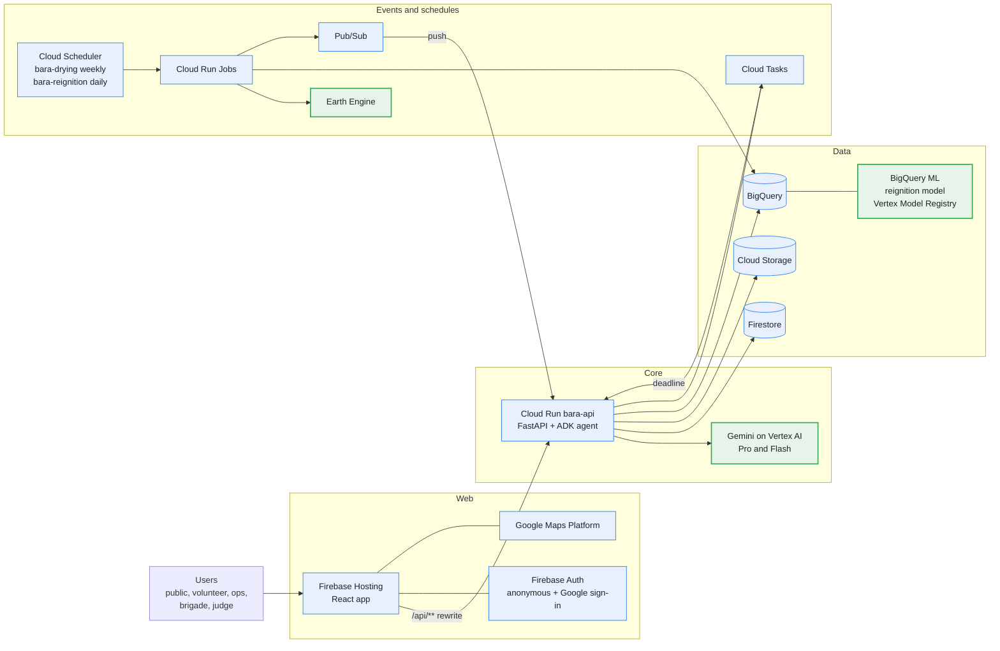

# Bara

> Submission for **Google Cloud AI Builder Cup 2026** by team **Faber Fathers**.
>
> - Rizqy EP (rizqyepr@gmail.com)
> - Rama Dhaniansyah (dhaniansyahr@gmail.com)
> - Rafizhafran Halmi (rzh.halim@gmail.com)
> - Ramel Akil Pratama (ramelakil76@gmail.com)

A Gemini agent on Google Cloud that ranks drying peat before the dry season, scores where a burned area
may reignite, sends a named person to check, reads their evidence, and escalates to the fire brigade.

Google Cloud AI Builder Cup 2026, Sustainability and Social Impact.

**Live: <https://ai-builder-cup-511906.web.app>**

The spec and the plans live in the team's internal docs. Every deviation from them is in [`docs/DECISIONS.md`](./docs/DECISIONS.md). The eval numbers are in [`docs/EVAL.md`](./docs/EVAL.md).

## Where it runs

- **Riau, Indonesia.** The Riau data is a peat area with a long fire history. We use it as the hardest test case. We do not run a field program there.
- **Congo Cuvette.** Drying ranking and map only.
- **Any drawn area.** Draw a polygon (up to 2,500 km2) inside the Riau or Congo data and Bara ranks it.

## Architecture



Legend: blue is a Google Cloud service. Green outline is an AI or geo-compute service (Vertex AI Gemini,
Earth Engine, BigQuery ML).

## Google Cloud services

- **Firebase Hosting:** serves the web app and rewrites `/api/**` to Cloud Run.
- **Cloud Run:** runs `bara-api` (FastAPI and the ADK agent) and `bara-jobs` (the batch jobs).
- **Cloud Run Jobs:** run the weekly drying score and the daily hotspot and re-ignition work.
- **Cloud Scheduler:** triggers `bara-drying` weekly and `bara-reignition` daily.
- **Vertex AI, Gemini:** Gemini 3.1 Pro for agent reasoning and Gemini 3.5 Flash for evidence reading and task wording, with a fallback model.
- **Agent Development Kit:** the agent that runs each case to closure: picks a person, assigns the task, reads the evidence, rechecks, escalates.
- **Earth Engine:** Sentinel-1, rainfall, peat and fire data for the drying score, the map tiles and drawn-area ranking.
- **BigQuery:** the 1 km grid, weekly drying scores, fire events and field-check labels. Every query has a byte cap.
- **BigQuery ML:** the re-ignition model `reignition_v1`, registered in the Vertex AI Model Registry.
- **Firestore:** cases, tasks, evidence and the rankings the dashboards read.
- **Cloud Storage:** evidence uploads through signed URLs, and data exports.
- **Pub/Sub:** events between detection, assignment, evidence, overdue tasks and escalation.
- **Cloud Tasks:** one scheduled call per task deadline.
- **Firebase Auth:** anonymous sign-in for the public and judges, Google sign-in for real users, roles from custom claims.
- **Google Maps Platform:** the base map and the ranked-cell layers on the dashboards.
- **Secret Manager:** the Maps key, the Firebase web config and the volunteer invite code.
- **Cloud Build and Artifact Registry:** build, test and deploy `main` to Cloud Run and Hosting.
- **Cloud Logging:** structured logs from `bara-api`.

## Scale and performance

Measured on the live site on 17 and 18 October 2026, or from the jobs' own runs. Rows in [`docs/DECISIONS.md`](./docs/DECISIONS.md) hold the reasoning where noted.

| What | Number |
|---|---|
| Cells scored each week | 3,769 Riau and 3,703 Congo (Congo cell count: DECISIONS, `congo_cuvette` row) |
| Back-fill | 23 weeks, 0 bytes billed |
| All-cells list (`GET /api/cells`) | 39 kB gzip; first load 2.8 s, cached 0.34 s (DECISIONS, `GET /api/cells?region=` row) |
| Map click to panel | about 25 ms; index lookup 3.4 µs at 3,769 cells |
| Area explanation | 1.4 to 1.6 s, was 29 s; precomputed for the top 200 |
| Agent steps | stream direct from Cloud Run: first step 6 to 9 s, done about 40 s. Through Hosting the stream was buffered and arrived at 63 s |
| Draw an area (100 km2) | 8.9 s first run, 0.21 s cached (DECISIONS, `POST /api/areas/rank` row) |
| Public routes | p50 0.11 to 0.25 s through the Hosting CDN cache; p50 0.24 to 0.49 s with the cache skipped (docs/EVAL.md) |
| Photo verdict | 4.1 s live |
| Voice verdict | 9.1 s live |
| Guided tour | 9 steps in 3:01 live |

Cost guards:

- Judge trigger: 1 per minute and 20 per day.
- Verdict cache: the same evidence is read once.
- Tile map-id cache: one Earth Engine call per layer and week.
- BigQuery: `maximum_bytes_billed` on every query.
- Drawn areas: 10 runs per hour per user (DECISIONS, `POST /api/areas/rank` row).
- Public routes: 60 requests per minute per client IP (DECISIONS, `/api/public/{region}/*` row).

## Evals

Full tables, method and the per-case results are in [`docs/EVAL.md`](./docs/EVAL.md); the raw numbers are in [`docs/eval.json`](./docs/eval.json).

| Eval | Result |
|---|---|
| Drying score lift, top 10% of Riau peat cells, hotspots 1 to 4 weeks later | 2019: 2.68x. 2023: 2.36x. 2026: 0.17x (362 detection-weeks, 6 captured: few fires this year) |
| Re-ignition model, test split (118 events, 13 positives) | AUC 0.662 for `reignition_v1`; the detection-days baseline scores 0.708 and wins |
| Photo verdicts (n = 40) | `dam_state` 82.5%, `smoke` 80%, `subject` 75% |
| Voice verdicts (n = 10) | `subject` 100%, `dam_state` 100% |
| ADK agent cases | 9 of 9 pass |

The 2026 lift and the re-ignition result are weak. EVAL.md says so and explains why.

## Data credits and licences

Sources used by the jobs (dataset ids in `config/app.yaml`):

| Data | Source |
|---|---|
| Sentinel-1 radar (`COPERNICUS/S1_GRD`) | Copernicus Sentinel data, ESA, via Earth Engine |
| Rainfall (`UCSB-CHG/CHIRPS/DAILY`) | CHIRPS, Climate Hazards Center, UC Santa Barbara |
| Peat extent (`GLOBAL-PEATLAND-DATABASE`) | Global Peatland Map 2.0, Greifswald Mire Centre (CC BY-NC-SA 4.0), via the Earth Engine community catalog |
| Burned area (`MODIS/061/MCD64A1`) | MODIS MCD64A1, NASA |
| Fire detections | NASA FIRMS (MODIS, VIIRS) |
| Canals | OpenStreetMap contributors, via the BigQuery public dataset `geo_openstreetmap` (ODbL) |

Test and sample media:

- `data/eval/photos/`: 40 photos from Wikimedia Commons and the U.S. Fish and Wildlife Service, under CC0, public domain, CC BY or CC BY-SA. Author, title, licence and source of each file: [`data/eval/LICENSES.md`](./data/eval/LICENSES.md).
- `data/samples/`: sample photos, areas and voice notes with their credits in [`data/samples/CREDITS.md`](./data/samples/CREDITS.md).
- Voice notes and sample areas are team-made, CC BY 4.0.

Public data exports are licensed CC BY-NC-SA 4.0, because the peat mask is.

## Run it locally

You need Python 3.12 with [uv](https://docs.astral.sh/uv/), [Bun](https://bun.sh), and `gcloud` logged in with application-default credentials for a project that has the services above.

```sh
git config core.hooksPath .githooks
mkdir -p .secrets && cp bara.env.example .secrets/bara.env
```

Set `PROJECT` in `.secrets/bara.env`. The pre-push hook runs [gitleaks](https://github.com/gitleaks/gitleaks/releases), so it must be on your `PATH`. `.secrets/` is gitignored; deployed services read secrets from Secret Manager only.

```sh
cd services/api && uv run pytest && uv run uvicorn --factory main:create_app --reload
cd apps/web && bun install && bun run dev
```

The web dev server opens on `http://localhost:5173`. Gates: `uv run ruff check . && uv run ruff format --check . && uv run pytest` in `services/api` and `services/pipelines`; `bun run check && bun run typecheck && bun run test && bun run build` in `apps/web`.

## Layout

| Path | What | Language |
|---|---|---|
| `services/api/` | Cloud Run service: FastAPI, the ADK agent, event handlers | Python 3.12 |
| `services/pipelines/` | Cloud Run Jobs: Earth Engine and BigQuery batch work | Python 3.12 |
| `apps/web/` | Web app on Firebase Hosting: Vite, React, TanStack Router and Query | TypeScript, Bun |
| `config/` | Thresholds, regions and model IDs. Logic reads these, never hard-coded values | YAML |
| `infra/`, `scripts/` | `gcloud` bootstrap, Cloud Build, preflight and smoke checks | bash |

## Grant a role to ops or brigade

The person signs in with Google once on the web app. Then, from the repo root:

```sh
uv run --project services/api python scripts/grant_role.py <email> <ops|brigade>
```

It prints `<uid> <role>`. Add `--dry-run` to look the user up and write nothing, `--project <id>` to override
`PROJECT`. The caller needs `roles/firebaseauth.admin` (ADC login). The person signs in again to get the new claim.
Exit codes: 2 usage, 3 no such user, 4 Firebase refused.

## Commits

`wave-N: <what>` (spec §19.9). Cloud Build deploys `main`.
